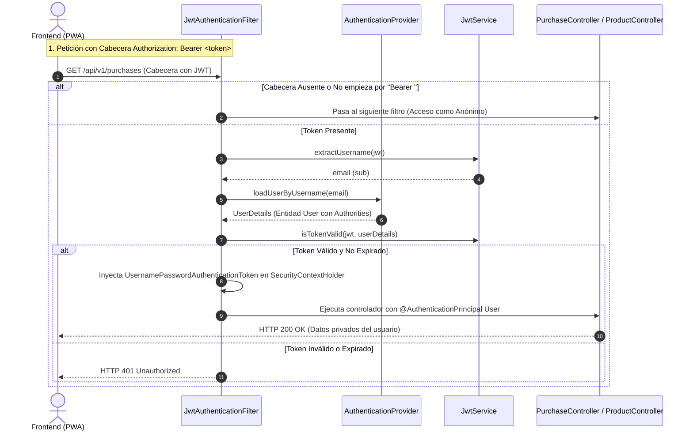
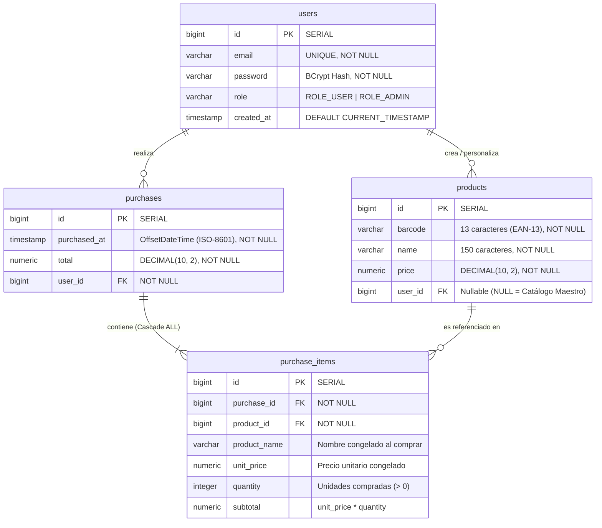

# 🚀 Mercat API — Backend REST, Spring Security & Catálogo Híbrido

<div align="center">


[](https://www.oracle.com/java/technologies/downloads/#java21)
[](https://spring.io/projects/spring-boot)
[](https://spring.io/projects/spring-security)
[](https://jwt.io/)
[](https://supabase.com/)
[](https://www.docker.com/)
[](https://render.com/)
[](LICENSE)

**Motor empresarial en la nube para el asistente de compras Mercat. Proporciona aislamiento multi-inquilino (*multi-tenant*), catálogo híbrido con bifurcación (*forking*) de productos, persistencia atómica transaccional de compras y seguridad *stateless* basada en tokens JWT.**

[Repositorio Frontend (Mercat_front)](https://github.com/Huligan-spring/Mercat_front.git) • [Demo en Vivo (PWA)](https://huligan-spring.github.io/Mercat_front/) • [Matriz de Endpoints](#-matriz-de-endpoints-rest)

</div>

---

## 📖 Índice de Contenidos

1. [Visión General del Sistema](#-visión-general-del-sistema)
2. [Arquitectura en Capas](#-arquitectura-en-capas)
3. [El Modelo de Catálogo Híbrido (Multi-Inquilino)](#-el-modelo-de-catálogo-híbrido-multi-inquilino)
4. [Seguridad Stateless & Autenticación JWT](#-seguridad-stateless--autenticación-jwt)
5. [Transaccionalidad e Inmutabilidad de Compras](#-transaccionalidad-e-inmutabilidad-de-compras)
6. [Diagramas Técnicos & Esquema de Base de Datos](#-diagramas-técnicos--esquema-de-base-de-datos)
   - [Diagrama Entidad-Relación (ER)](#a-diagrama-entidad-relación-er)
   - [Esquema DDL SQL & Índices Condicionales](#b-esquema-ddl-sql--índices-condicionales-postgresql--supabase)
   - [Flujo de Autenticación y Autorización](#c-flujo-de-autenticación-y-autorización-jwt)
7. [Matriz de Endpoints REST](#-matriz-de-endpoints-rest)
8. [Optimizaciones de Infraestructura & Cloud (Render + Supabase)](#-optimizaciones-de-infraestructura--cloud-render--supabase)
9. [Despliegue con Docker (Multi-stage Build)](#-despliegue-con-docker-multi-stage-build)
10. [Variables de Entorno](#-variables-de-entorno)
11. [Puesta en Marcha en Local](#-puesta-en-marcha-en-local)

---

## 🌐 Visión General del Sistema

**Mercat API** es el núcleo de backend para el asistente de compras de supermercado **Mercat**. Diseñado con una arquitectura desacoplada y moderna, atiende las peticiones del cliente móvil PWA ([Mercat_front](https://github.com/Huligan-spring/Mercat_front.git)) alojado en GitHub Pages.

### Principales Desafíos Resueltos:
- **Modelo de Datos Híbrido:** Concilia un catálogo central compartido (con miles de productos verificados) con la libertad de que cualquier comprador añada artículos propios o adapte precios locales sin corromper la base de datos común.
- **Seguridad sin Estado (*Stateless*):** Autenticación de alta velocidad mediante tokens JWT (HS256) sin almacenar sesiones en memoria, lo que permite escalabilidad horizontal inmediata.
- **Rendimiento en Entornos Cloud Gratuitos:** Optimización exhaustiva del pool de conexiones JDBC (**HikariCP**) y de la memoria JVM de Java 21 (`-Xmx350m`) para operar de forma estable en instancias con solo 512 MB de RAM en Render y límites estrictos de conexión en Supabase.
- **Cálculo Financiero Exacto:** Manejo riguroso de precios y totales mediante `BigDecimal` para evitar errores de redondeo inherentes a los tipos de punto flotante binarios (`float`/`double`).

---

## 🏛 Arquitectura en Capas

El backend sigue estrictamente el patrón de diseño por capas de Spring Framework, garantizando alta cohesión, bajo acoplamiento y facilidad de mantenimiento:

```text
com.curso.mercat/
├── controller/            # Capa Web REST (Endpoints HTTP, validación y CORS)
│   ├── AuthController.java
│   ├── ProductController.java
│   └── PurchaseController.java
├── dto/                   # Data Transfer Objects (Payloads de petición y respuesta)
│   ├── AuthResponse.java
│   ├── CartItemRequest.java
│   ├── CheckoutRequest.java
│   ├── LoginRequest.java
│   ├── ProductRequestDTO.java
│   └── RegisterRequest.java
├── model/                 # Entidades JPA / Hibernate (Tablas de base de datos)
│   ├── Product.java
│   ├── Purchase.java
│   ├── PurchaseItem.java
│   ├── Role.java          # Enum: ROLE_USER, ROLE_ADMIN
│   └── User.java          # Implementa UserDetails de Spring Security
├── repository/            # Capa de Acceso a Datos (Spring Data JPA + SQL Nativo)
│   ├── ProductRepository.java
│   ├── PurchaseItemRepository.java
│   ├── PurchaseRepository.java
│   └── UserRepository.java
├── security/              # Infraestructura de Seguridad y Filtros JWT
│   ├── ApplicationConfig.java
│   ├── JwtAuthenticationFilter.java
│   ├── JwtService.java
│   └── SecurityConfig.java
└── service/               # Capa de Negocio Transaccional (@Transactional)
    ├── AuthenticationService.java
    ├── ProductService.java
    └── PurchaseService.java
```

---

## 🧩 El Modelo de Catálogo Híbrido (Multi-Inquilino)

El gran valor diferencial de Mercat API radica en su gestión inteligente del catálogo:

```text
┌────────────────────────────────────────────────────────────────────────┐
│                   TABLA POSTGRESQL: "products"                         │
├────┬───────────────┬────────────────────────────┬────────┬─────────────┤
│ id │ barcode       │ name                       │ price  │ user_id     │
├────┼───────────────┼────────────────────────────┼────────┼─────────────┤
│  1 │ 8480000861900 │ Pistacho tostado 0% sal    │   3.40 │ NULL        │ <-- Global (Maestro)
│  2 │ 8480000340245 │ Nuez natural 200g          │   2.50 │ NULL        │ <-- Global (Maestro)
│ 14 │ 8480000861900 │ Pistacho tostado (Oferta)  │   2.99 │ 5           │ <-- Personal de Usuario #5
│ 15 │ 8410000000001 │ Pan de masa madre artesano │   1.80 │ 5           │ <-- Producto propio #5
└────┴───────────────┴────────────────────────────┴────────┴─────────────┘
```

### 1. Catálogo Maestro Global (`user_id = NULL`)
- Visible públicamente para todos los usuarios (incluso en modo invitado sin iniciar sesión).
- Únicamente los administradores (`ROLE_ADMIN`) tienen privilegios para crear, editar o eliminar registros globales (`makeGlobal: true`).
- Protegido por índices condicionales en PostgreSQL para garantizar un código de barras único en el catálogo común.

### 2. Catálogo Personalizado / Bifurcado (*Catalog Forking*)
- Cuando un usuario estándar (`ROLE_USER`) escanea un código que no existe o desea registrar una versión propia con distinto nombre o precio:
  - Si ya posee una copia propia: se actualiza directamente.
  - Si no la tiene: se bifurca (*fork*) creando un nuevo registro con su `user_id`.
  - El catálogo maestro **nunca se ve alterado ni afectado**, garantizando la integridad de los datos para el resto de usuarios.

### 3. Consultas SQL Nativas con Prioridad Dinámica
Para resolver las consultas en un solo viaje de ida y vuelta a la base de datos (*single round-trip*), `ProductRepository` implementa consultas nativas avanzadas de PostgreSQL:

#### A. Consulta de Producto Efectivo (Lectura por Código EAN):
```sql
SELECT * FROM products 
WHERE barcode = :barcode 
  AND (user_id = :userId OR user_id IS NULL)
ORDER BY user_id DESC NULLS LAST
LIMIT 1;
```
> **¿Cómo funciona?**  
> Si el usuario tiene una copia personalizada (`user_id = 5`), el ordenamiento descendente con `NULLS LAST` coloca el valor `5` por delante del `NULL` global. Por tanto, `LIMIT 1` devuelve la versión personalizada del usuario. Si el usuario no ha personalizado el producto, devuelve la versión global.

#### B. Búsqueda Predictiva de Sugerencias sin Duplicados:
```sql
SELECT DISTINCT ON (barcode) * FROM products
WHERE (user_id = :userId OR user_id IS NULL)
  AND (LOWER(name) LIKE LOWER(CONCAT('%', :query, '%')) OR barcode LIKE CONCAT('%', :query, '%'))
ORDER BY barcode, user_id DESC NULLS LAST
LIMIT 6;
```
> **¿Cómo funciona?**  
> `DISTINCT ON (barcode)` combinado con `ORDER BY barcode, user_id DESC NULLS LAST` asegura que, si coinciden un producto global y uno personal con el mismo código de barras, PostgreSQL seleccione únicamente la versión personalizada del usuario, descartando el duplicado y limitando el resultado a las 6 mejores sugerencias en milisegundos.

---

## 🛡️ Seguridad Stateless & Autenticación JWT

La aplicación utiliza **Spring Security 6** configurado en modo puramente sin estado (*stateless*):



### Especificación de los Tokens JWT:
- **Algoritmo:** HMAC-SHA256 (`HS256`).
- **Sujeto (`sub`):** Correo electrónico del usuario.
- **Fechas:** Emisión (`iat`) y expiración configurable (`exp`, por defecto 24 horas).
- **Contraseñas:** Encriptadas mediante **BCrypt** con salt aleatorio antes de persistirse en la tabla `users`.

---

## 💰 Transaccionalidad e Inmutabilidad de Compras

El procesamiento de compras implementa el patrón **Command / Checkout Transaccional**:

```java
@Transactional
public Purchase checkout(CheckoutRequest request, User user) {
    // 1. Valida que el carrito contenga artículos
    // 2. Itera sobre cada CartItemRequest verificando la existencia del producto en el catálogo
    // 3. Congela el nombre y el precio unitario del momento de la compra en PurchaseItem
    // 4. Calcula el subtotal (unitPrice x quantity) y el total acumulado con BigDecimal
    // 5. Guarda la compra y, por cascada atómica (CascadeType.ALL), todos sus PurchaseItems
}
```

### Inmutabilidad Histórica Garantizada:
La entidad `PurchaseItem` almacena de forma redundante y desacoplada las columnas `product_name` y `unit_price`. De este modo:
- Si el administrador o el usuario cambian el precio de un artículo mañana, **los tiquets del pasado no se alteran**.
- Si un producto es eliminado del catálogo, el registro histórico del tiquet y sus importes se conservan íntegros.

---

## 📊 Diagramas Técnicos

### A. Diagrama Entidad-Relación (ER)



### B. Esquema DDL SQL & Índices Condicionales (PostgreSQL / Supabase)

El script SQL completo se encuentra disponible en [`database/schema.sql`](database/schema.sql). Incluye las definiciones DDL exactas, claves foráneas y los **índices parciales condicionales** imprescindibles para el catálogo híbrido que Hibernate no genera de forma automática:

```sql
-- 1. TABLA: USERS (Usuarios y Roles de Spring Security)
CREATE TABLE users (
    id BIGSERIAL PRIMARY KEY,
    email VARCHAR(150) NOT NULL UNIQUE,
    password VARCHAR(255) NOT NULL,
    role VARCHAR(20) NOT NULL DEFAULT 'ROLE_USER',
    created_at TIMESTAMP WITH TIME ZONE NOT NULL DEFAULT CURRENT_TIMESTAMP
);

-- 2. TABLA: PRODUCTS (Catálogo Híbrido: Maestro Global vs. Personal)
CREATE TABLE products (
    id BIGSERIAL PRIMARY KEY,
    barcode VARCHAR(13) NOT NULL,
    name VARCHAR(150) NOT NULL,
    price NUMERIC(10, 2) NOT NULL CHECK (price >= 0),
    user_id BIGINT REFERENCES users(id) ON DELETE CASCADE
);

-- ÍNDICES CONDICIONALES PARA EL MODELO HÍBRIDO (POSTGRESQL):
-- Unicidad en catálogo global (solo puede haber un código único con user_id NULL)
CREATE UNIQUE INDEX idx_products_barcode_global 
ON products (barcode) 
WHERE user_id IS NULL;

-- Unicidad personal (un usuario solo puede tener una versión personalizada por código)
CREATE UNIQUE INDEX idx_products_barcode_user 
ON products (barcode, user_id) 
WHERE user_id IS NOT NULL;

-- Optimización de consulta de prioridad Personal > Global (ORDER BY user_id DESC NULLS LAST)
CREATE INDEX idx_products_lookup 
ON products (barcode, user_id DESC NULLS LAST);

-- Optimización de autocompletado insensible a mayúsculas
CREATE INDEX idx_products_search 
ON products (user_id, LOWER(name));

-- 3. TABLA: PURCHASES (Cabeceras de Compra Atómica)
CREATE TABLE purchases (
    id BIGSERIAL PRIMARY KEY,
    purchased_at TIMESTAMP WITH TIME ZONE NOT NULL DEFAULT CURRENT_TIMESTAMP,
    total NUMERIC(10, 2) NOT NULL CHECK (total >= 0),
    user_id BIGINT NOT NULL REFERENCES users(id) ON DELETE CASCADE
);

-- 4. TABLA: PURCHASE_ITEMS (Líneas de Compra con Precios Históricos Congelados)
CREATE TABLE purchase_items (
    id BIGSERIAL PRIMARY KEY,
    purchase_id BIGINT NOT NULL REFERENCES purchases(id) ON DELETE CASCADE,
    product_id BIGINT NOT NULL REFERENCES products(id) ON DELETE RESTRICT,
    product_name VARCHAR(150) NOT NULL,
    unit_price NUMERIC(10, 2) NOT NULL CHECK (unit_price >= 0),
    quantity INTEGER NOT NULL CHECK (quantity > 0),
    subtotal NUMERIC(10, 2) NOT NULL CHECK (subtotal >= 0)
);
```

---

## 📡 Matriz de Endpoints REST

La API se publica bajo el prefijo `/api/v1` y admite CORS abierto desde cualquier origen para servir al cliente PWA:

### 1. Módulo de Autenticación (`/api/v1/auth`)

| Método | Endpoint | Acceso | Código Éxito | Descripción |
| :---: | :--- | :---: | :---: | :--- |
| **POST** | `/api/v1/auth/register` | Público | `201 Created` | Registra un nuevo usuario con rol `ROLE_USER`. |
| **POST** | `/api/v1/auth/login` | Público | `200 OK` | Autentica con email y contraseña; emite el token JWT. |

#### Ejemplo de Petición de Login:
```bash
curl -X POST "https://mercat-backend-6mxo.onrender.com/api/v1/auth/login" \
     -H "Content-Type: application/json" \
     -d '{"email": "usuario@mercat.com", "password": "miPasswordSeguro123"}'
```

#### Respuesta (200 OK):
```json
{
  "token": "eyJhbGciOiJIUzI1NiJ9.eyJzdWIiOiJ1c3VhcmlvQG1lcmNhdC5jb20i...",
  "email": "usuario@mercat.com",
  "role": "ROLE_USER"
}
```

---

### 2. Módulo de Catálogo de Productos (`/api/v1/products`)

| Método | Endpoint | Cabecera Requerida | Código Éxito | Comportamiento |
| :---: | :--- | :---: | :---: | :--- |
| **GET** | `/api/v1/products/by-barcode/{code}` | Opcional (`Bearer <token>`) | `200 OK` / `404` | Si lleva token, aplica prioridad Personal > Global. Si es invitado, busca solo global. |
| **GET** | `/api/v1/products/search?q={query}` | Opcional (`Bearer <token>`) | `200 OK` | Autocompletado: hasta 6 sugerencias combinadas sin códigos duplicados. |
| **POST** | `/api/v1/products` | Obligatoria (`Bearer <token>`) | `201 Created` | Si es `ROLE_USER`, crea/actualiza copia personal. Si es `ROLE_ADMIN` y `makeGlobal: true`, actualiza catálogo maestro. |
| **DELETE**| `/api/v1/products/{code}` | Obligatoria (`Bearer <token>`) | `204 No Content` | Elimina la versión personal del usuario (o global si es `ROLE_ADMIN`). |

#### Payload para Alta/Modificación de Producto:
```json
{
  "barcode": "8480000861900",
  "name": "Pistacho tostado 0% sal",
  "price": 3.40,
  "makeGlobal": false
}
```

---

### 3. Módulo de Compras y Tiquets (`/api/v1/purchases`)

| Método | Endpoint | Cabecera Requerida | Código Éxito | Comportamiento |
| :---: | :--- | :---: | :---: | :--- |
| **POST** | `/api/v1/purchases` | Obligatoria (`Bearer <token>`) | `201 Created` | Persiste atómicamente la compra vinculada al usuario autenticado. |
| **GET** | `/api/v1/purchases` | Obligatoria (`Bearer <token>`) | `200 OK` | Devuelve el histórico de tiquets exclusivo del usuario autenticado ordenado por fecha desc. |

#### Ejemplo de Petición de Compra:
```json
{
  "items": [
    { "productId": 1, "quantity": 2 },
    { "productId": 4, "quantity": 1 }
  ]
}
```

#### Respuesta (201 Created):
```json
{
  "id": 6,
  "purchasedAt": "2026-10-24T11:26:16.938996+02:00",
  "total": 9.30,
  "items": [
    {
      "id": 14,
      "productName": "Pistacho tostado 0% sal",
      "unitPrice": 3.40,
      "quantity": 2,
      "subtotal": 6.80
    },
    {
      "id": 15,
      "productName": "Nuez natural 200g",
      "unitPrice": 2.50,
      "quantity": 1,
      "subtotal": 2.50
    }
  ]
}
```

---

## ⚡ Optimizaciones de Infraestructura & Cloud (Render + Supabase)

El backend incorpora ajustes para convivir con los límites del plan gratuito de Render y Supabase:

1. **Gestión del Pool de Conexiones (HikariCP):**
   ```properties
   spring.datasource.hikari.maximum-pool-size=5
   spring.datasource.hikari.minimum-idle=2
   spring.datasource.hikari.idle-timeout=30000
   spring.datasource.hikari.max-lifetime=60000
   ```
   *Evita agotar el pooler de PostgreSQL de Supabase (límite de 15 conexiones concurrentes).*

2. **Control de Memoria JVM para Evitar Out-Of-Memory (OOM):**
   ```text
   java -Xmx350m -Xms256m -jar app.jar
   ```
   *Garantiza que la máquina virtual Java nunca sobrepase el tope de 512 MB de RAM asignado por Render.*

3. **Compatibilidad con IPv4 en Supabase:**
   *Utiliza el Session Pooler en el puerto 5432 / 6543 para garantizar conectividad directa desde entornos cloud que no disponen de direccionamiento IPv6 nativo.*

---

## 🐳 Despliegue con Docker (Multi-stage Build)

El repositorio incluye un `Dockerfile` optimizado en dos fases:

```dockerfile
# Fase 1: Compilación con Maven y JDK 21
FROM maven:3.9.6-eclipse-temurin-21 AS build
WORKDIR /app
COPY pom.xml .
COPY src ./src
RUN mvn clean package -DskipTests

# Fase 2: Imagen de ejecución ligera con JRE 21
FROM eclipse-temurin:21-jre-jammy
WORKDIR /app
COPY --from=build /app/target/*.jar app.jar
ENTRYPOINT ["java", "-Xmx350m", "-Xms256m", "-jar", "app.jar"]
```
- **Ventaja:** La imagen resultante no contiene Maven, dependencias temporales ni código fuente, reduciendo el tamaño a unos ~250 MB y acelerando el arranque en Render.

---

## 🔐 Variables de Entorno

Para ejecutar la aplicación (tanto en local como en el panel de configuración de Render), se requieren las siguientes variables:

| Variable | Descripción | Ejemplo / Valor |
| :--- | :--- | :--- |
| `SPRING_DATASOURCE_URL` | URL JDBC de conexión con Supabase | `jdbc:postgresql://aws-0-eu-central-1.pooler.supabase.com:5432/postgres?sslmode=require` |
| `SPRING_DATASOURCE_USERNAME` | Usuario de la base de datos | `postgres.your-project-id` |
| `SPRING_DATASOURCE_PASSWORD` | Contraseña de la base de datos | `tu_password_seguro` |
| `JWT_SECRET` | Clave secreta para firmar tokens HS256 | `cadena_hexadecimal_o_base64_de_minimo_256_bits` |
| `JWT_EXPIRATION_MS` | Tiempo de vida del token en milisegundos | `86400000` (24 horas) |
| `PORT` | Puerto de escucha (asignado por Render) | `8080` |

---

## 🛠️ Puesta en Marcha en Local

### Requisitos Previos:
- **Java 21 LTS** instalado (`java -version`).
- Acceso a una base de datos PostgreSQL activa (local o Supabase).

### Pasos:

1. **Clonar el repositorio:**
   ```bash
   git clone https://github.com/Huligan-spring/Mercat.git
   cd Mercat/Mercat
   ```

2. **Configurar las variables de entorno:**
   En Windows (PowerShell):
   ```powershell
   $env:SPRING_DATASOURCE_URL="jdbc:postgresql://localhost:5432/mercat"
   $env:SPRING_DATASOURCE_USERNAME="postgres"
   $env:SPRING_DATASOURCE_PASSWORD="password"
   $env:JWT_SECRET="miClaveSecretaSuperSeguraParaFirmarJwtDeMinimo256Bits12345"
   $env:JWT_EXPIRATION_MS="86400000"
   ```

3. **Compilar y empaquetar con Maven:**
   ```bash
   ./mvnw clean package -DskipTests
   ```

4. **Ejecutar la aplicación:**
   ```bash
   ./mvnw spring-boot:run
   ```
   La API estará lista y escuchando en `http://localhost:8080/api/v1`.

---

<div align="center">

Diseñado como parte del ecosistema **Mercat Asistent**.  
**Mercat API** • Código abierto bajo [Licencia MIT](LICENSE)

</div>
